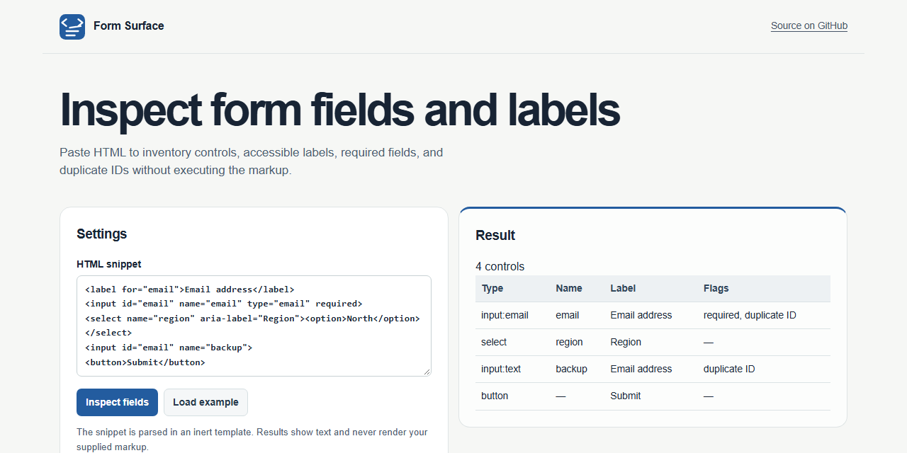

# Form Surface

**Inspect form fields and labels.** Paste HTML to inventory controls, accessible labels, required fields, and duplicate IDs without executing the markup.

[Open the live tool](https://musabukhari237.github.io/form-surface/) · [Report an issue](https://github.com/MusaBukhari237/form-surface/issues)

[](https://musabukhari237.github.io/form-surface/)

## Try an example

Load the example and inspect it. Four controls appear, including missing labels and duplicate IDs.

## Usage and limits

This is a markup inventory with common label rules, not a complete accessible-name algorithm or live accessibility audit. It examines the pasted HTML without running scripts or resolving external resources.

## Run locally

Clone this repository, then run:

```sh
python -m http.server 8000 --bind 127.0.0.1 --directory docs
```

Open http://127.0.0.1:8000 in a browser. The site needs no package install. Run `node --test` with Node.js 22 or newer.

## Sponsors

Supported by [LeadCeleris](https://www.leadceleris.com/) and [AIFFICIENTO](https://www.aifficiento.biz/).

## Contributing and license

Use synthetic input in bug reports and contributions. See [contribution notes](CONTRIBUTING.md) and the [MIT license](LICENSE).
